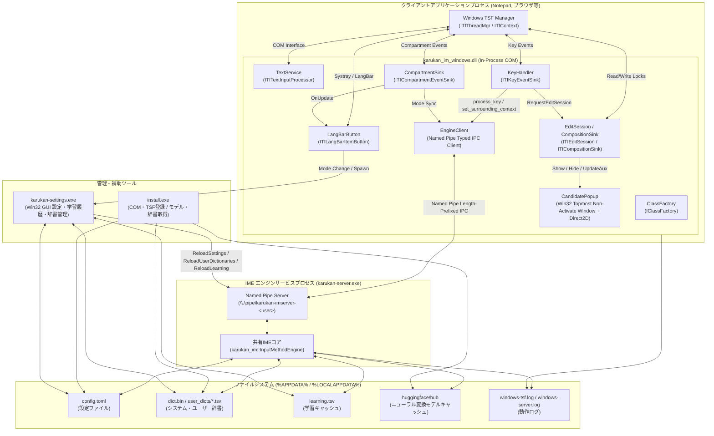
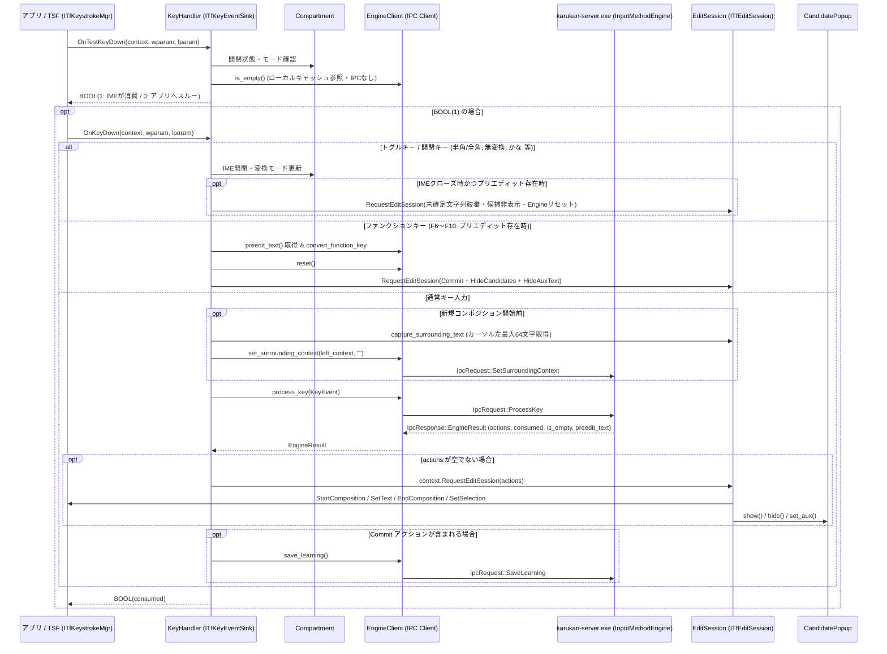

# Karukan for Windows フロントエンド設計書

## 1. 概要

### 1.1 目的
本書は、日本語IMEエンジン「Karukan」(`karukan-im` / `karukan-engine`) を Windows 11 (x64) 上で利用可能にする **Text Services Framework (TSF) フロントエンド** (`karukan-im-windows`) のアーキテクチャおよび詳細設計を定義する。

### 1.2 スコープと成果物
Windowsフロントエンドクレート (`Cargo.toml`) は、以下の4つの主要バイナリで構成される。一般的なWindows IME（Mozc / Google 日本語入力など）と同様に、システム辞書・ユーザー辞書・学習履歴・ニューラル変換モデルへのアクセスは単一のバックグラウンドサービスプロセス (`karukan-server.exe`) に集約し、各アプリケーションにロードされる TSF DLL (`karukan_im_windows.dll`) は名前付きパイプ IPC クライアントとして動作する。

| 成果物 | 種別 | 役割 | 主要エントリポイント |
| :--- | :--- | :--- | :--- |
| `karukan_im_windows.dll` | COM In-Proc Server (`cdylib`) | TSF Text Input Processor (TIP) 本体。各ターゲットプロセスにロードされ、キーフック・プリエディット操作・候補ウィンドウ表示・言語バー連携を行い、変換・辞書処理は `karukan-server.exe` へ IPC 委譲する。 | `src/lib.rs`, `src/tsf/mod.rs`, `src/ipc.rs`, `src/engine_client.rs` |
| `karukan-server.exe` | バックグラウンドエンジンサービス (`bin`) | ユーザーセッション単位で常駐する変換・辞書サービス。名前付きパイプ (`\\.\pipe\karukan-imserver-<username>`) 上で `InputMethodEngine` を直接ホストし、システム辞書・ユーザー辞書・学習履歴キャッシュ・LLMモデルを一元管理する。 | `src/bin/server.rs`, `src/ipc.rs` |
| `install.exe` | CLI インストーラー (`bin`) | DLL・サービス・設定アプリの配置、レジストリ (COM CLSID) 登録、TSF プロファイル/カテゴリ登録、システム辞書・LLMモデル (`tokenizer.json` 含む) の事前取得およびサービスの起動を行う。 | `src/bin/install.rs` |
| `karukan-settings.exe` | Win32 GUI アプリ (`bin`) | 設定 (`config.toml`) のGUI編集、学習履歴 (`learning.tsv`) の閲覧・削除、Mozc互換ユーザー辞書 (`karukan-user.tsv`) の管理、ライセンス表示を行い、保存時は実行中の `karukan-server.exe` へ即時リロードを通知する。 | `src/bin/settings.rs` |

---

## 2. システムアーキテクチャ

### 2.1 コンポーネント構成図



### 2.2 ビルド方針（静的CRTリンク）
- クライアントアプリケーションの環境に依存せず任意のプロセスへ安全にインプロセスDLLをロードさせるため、RustおよびC/C++依存ライブラリ（`llama.cpp` 等）は静的CRT (`/MT`) でリンクする（`build-windows.ps1`）。

---

## 3. TSF識別子とカテゴリ設計

`src/lib.rs` で定義される各種GUIDおよび定数は以下の通り。

### 3.1 基本GUID
- **`CLSID_KARUKAN_TIP`**: `7d7a2c6e-4d65-4ab8-8f30-4a1f2c83f81b` (COM クラスID)
- **`GUID_KARUKAN_PROFILE`**: `9d8e6e3a-8f6d-45d3-a0b1-9b1e391f01a1` (TSF 言語プロファイルID、言語: `0x0411` 日本語)
- **`GUID_PRESERVEDKEY_TOGGLE`**: `7d7a2c6e-4d65-4ab8-8f30-4a1f2c83f81c` (IME ON/OFF トグル用予約キーGUID)

### 3.2 サポートするTSFカテゴリ (`ITfCategoryMgr`)
Windows 11 のデスクトップアプリ、UWP / WinUI 3 (Immersive) アプリ、システムトレイ統合に対応するため、以下のカテゴリに登録する。
- `GUID_TFCAT_TIP_KEYBOARD`: キーボードTIP
- `GUID_TFCAT_DISPLAYATTRIBUTEPROVIDER`: 表示属性プロバイダ
- `GUID_TFCAT_TIPCAP_SYSTRAYSUPPORT`: システムトレイ（言語バー）サポート
- `GUID_TFCAT_TIPCAP_IMMERSIVESUPPORT`: Windows 8/10/11 モダンアプリ (UWP / WinUI) 対応
- `GUID_TFCAT_TIPCAP_INPUTMODECOMPARTMENT`: 入力モードCompartment対応
- `GUID_TFCAT_TIPCAP_UIELEMENTENABLED`: UIElement対応
- `GUID_TFCAT_TIPCAP_SECUREMODE`: セキュアモード対応
- `GUID_TFCAT_TIPCAP_COMLESS`: COMレスアクティベーション対応

---

## 4. モジュール詳細設計

### 4.1 COM エントリポイント (`src/tsf/mod.rs`)
- **`DllGetClassObject`**:
  - 初回呼び出し時に `Once` でロガー (`tracing_subscriber`) を初期化し、`%LOCALAPPDATA%\karukan\karukan-im\logs\windows-tsf.log` へプロセスID・実行ファイル名付きでログを出力する。
  - 要求された `CLSID` が `CLSID_KARUKAN_TIP` と一致する場合、`ClassFactory` (`IClassFactory`) を返す。
- **`ClassFactory::CreateInstance`**:
  - アグリゲーション (`outer != null`) は拒否 (`CLASS_E_NOAGGREGATION`) し、`TextService` インスタンスを生成して `ITfTextInputProcessor` 等へ QueryInterface する。
- **`DllCanUnloadNow`**:
  - 常に `S_FALSE` を返し、ホストプロセス終了までDLLのアンロードを抑止してスレッドローカルリソースやフックの安全性を保つ。

### 4.2 テキストサービス管理 (`src/tsf/text_service.rs`)
`TextService` は `ITfTextInputProcessor` を実装し、TSFスレッドごとのライフサイクルを管理する。

#### `Activate(thread_mgr, thread_id)`
1. **モデルキャッシュパスの構成**: 環境変数 (`HF_HUB_CACHE`, `HF_HOME` 等) が未設定の場合、`%LOCALAPPDATA%\huggingface\hub` を `HF_HUB_CACHE` に設定する。
2. **エンジンクライアント初期化**: `EngineClient::new()` を生成して `Rc<EngineClient>` に格納する。`engine.init()` では単一インスタンスミューテックス (`Local\KarukanImServerMutex-<username>`) の存在を確認し、`karukan-server.exe` が未起動の場合のみ非同期でバックグラウンド起動する（UIスレッドをブロックする同期パイプ接続は行わず、初回キー入力時に遅延接続する）。
3. **キーイベントシンク登録**: `KeyHandler` および `ITfThreadFocusSink` を登録し、`ITfKeystrokeMgr::AdviseKeyEventSink` でフォアグラウンドシンクとして登録する。
4. **予約キー (`PreservedKey`) の登録**:
   - `VK_KANJI` (`0x19`), `VK_OEM_AUTO` (`0xF3`), `VK_OEM_ENLW` (`0xF4`), `Alt + VK_OEM_3` (`0xC0`) を `GUID_PRESERVEDKEY_TOGGLE` として登録し、IMEの開閉トグルを確実に捕捉する。
5. **Compartment イベント監視と初期化**:
   - グローバル Compartment の `GUID_COMPARTMENT_KEYBOARD_OPENCLOSE` (IME ON/OFF) と `GUID_COMPARTMENT_KEYBOARD_INPUTMODE_CONVERSION` (変換モード) に `CompartmentSink` を接続。
   - 初期状態を Open (`true`)、変換モードを `TF_CONVERSIONMODE_NATIVE | TF_CONVERSIONMODE_FULLSHAPE | TF_CONVERSIONMODE_ROMAN`（ひらがなモード）に設定。
6. **言語バーボタン登録**:
   - `ITfLangBarItemMgr::AddItem` を通じて `LangBarButton` をシステムトレイに登録する。

#### `Deactivate()`
1. 登録した `PreservedKey` の解除 (`UnpreserveKey`) と `KeyEventSink` の解除 (`UnadviseKeyEventSink`)。
2. `CompartmentSink` および `ITfThreadFocusSink` の `UnadviseSink` と `LangBarButton` の `RemoveItem`。
3. **`engine.save_learning()` の呼び出し**: セッション中に確定（学習更新）が発生していた場合のみ、サービスへ学習履歴キャッシュのディスク保存を要求する。

---

### 4.3 エンジンサービスと名前付きパイプ IPC (`src/bin/server.rs`, `src/ipc.rs`, `src/engine_client.rs`)

#### 4.3.1 サービスプロセス (`karukan-server.exe`)
- **単一インスタンス保証**: `Local\KarukanImServerMutex-<username>` ミューテックスにより、ユーザーセッションごとに1プロセスのみ常駐する。
- **エンジン一元保持**: 専用ワーカースレッド (`karukan-engine-worker`) 上で `karukan_im::InputMethodEngine` を直接生成・初期化し、システム辞書 (`dict.bin`)、ユーザー辞書 (`user_dicts/*.tsv`)、学習履歴キャッシュ (`learning.tsv`)、および変換モデル (`llama.cpp` GGUF) をプロセス内で一元管理する。
- **AppContainer / UWP 対応セキュリティ記述子 (DACL)**:
  - Win32 デスクトップアプリだけでなく、Windows 11 メモ帳などの UWP / WinUI 3 (AppContainer) アプリや低整合性プロセスからもパイプ接続できるよう、`ConvertStringSecurityDescriptorToSecurityDescriptorW` で `D:(A;;GA;;;SY)(A;;GA;;;BA)(A;;GA;;;AU)(A;;GA;;;AC)S:(ML;;NWNR;;;LW)` を設定して `CreateNamedPipeW` を呼び出す。
- **先行パイプインスタンス生成**: クライアント接続 (`ConnectNamedPipe`) を受け入れた直後、ハンドラスレッドを起動する前に次の待受パイプインスタンスを生成することで、複数スレッドからの同時接続時にも `ERROR_FILE_NOT_FOUND` を防ぐ。

#### 4.3.2 パイプストリームとプロトコル (`PipeStream`, `IpcRequest`, `IpcResponse`)
- **単一ハンドル半二重フレーム通信 (`PipeStream`)**:
  - Windows の非 Overlapped（同期）名前付きパイプで `DuplicateHandle` (`File::try_clone`) を使うとカーネル内で読み書きロック競合が起きるため、単一 `HANDLE` に対して直接 Win32 `WriteFile` / `ReadFile` を呼び出す。
  - 各メッセージは `u32` (Little-Endian 4バイト長プレフィックス) + UTF-8 JSON ペイロードのフレーム形式で送受信する。
- **ローカル状態キャッシュとゼロ IPC 最適化 (`EngineClient`)**:
  - サーバーからの全レスポンス (`IpcResponse::Ack` / `IpcResponse::EngineResult`) に最新の `is_empty` と `preedit_text` を同梱し、クライアント側でキャッシュする。
  - これにより、`OnTestKeyDown` でのキー消費判定や、未入力状態 (`is_empty == true`) でのステータスバー（言語バー）モード切替、`CompartmentSink::OnChange`、フォーカス移動 (`OnSetFocus`)、`reset()`、`save_learning()` では **IPC 通信を一切発行せず 0ms で即時完了** させる。

---

### 4.4 キー入力処理 (`src/tsf/key_handler.rs`)
`KeyHandler` は `ITfKeyEventSink` および `ITfThreadFocusSink` を実装し、Windows の仮想キー (`VK_*`) とスキャンコードを Karukan コアの `KeyEvent` (`Keysym`, `KeyModifiers`) に変換して `EngineClient` 経由でサービスへディスパッチする。

#### 4.4.1 キー入力シーケンス



#### 4.4.2 特殊キー・モード制御仕様
| キー種別 | 対象仮想キー | 動作 |
| :--- | :--- | :--- |
| **IMEトグル** | `VK_KANJI` (`0x19`), `VK_OEM_AUTO` (`0xF3`), `VK_OEM_ENLW` (`0xF4`), `Alt + ~` (`0xC0`) | IMEのON/OFFを切り替える。OFF遷移時はアクティブなCompositionを終了しエンジンをリセットする。 |
| **直接入力 (IME OFF)** | `VK_NONCONVERT` (無変換), `VK_DBE_ALPHANUMERIC` (英数), `VK_IME_OFF` (`0x1A`) | IMEをOFF (`TF_CONVERSIONMODE_ALPHANUMERIC`) に切り替える。 |
| **日本語入力 (IME ON / ひらがな復帰)** | `VK_CONVERT` (変換), `VK_KANA` (かな), `VK_DBE_HIRAGANA` (`0xF2`), `VK_IME_ON` (`0x16`) | IMEがOFFならONにする。ON時はひらがなモードへ戻し、エンジンの `Keysym::HENKAN` を送出してサブモード復帰を行う。 |
| **フォーカス喪失時** | `ITfKeyEventSink::OnSetFocus(FALSE)` | 候補ウィンドウと補助テキストを即座に非表示にし、コンポジション（未確定文字列）を終了破棄して、エンジンを初期状態 (`reset()`) へ即時移行する。 |
| **文字種一括変換** | `F6` (`0x75`) 〜 `F10` (`0x79`) | プリエディット中に押下された場合、F6:ひらがな候補、F7:全角カタカナ候補、F8:半角ｶﾀｶﾅ候補を表示し、F9:全角英数、F10:半角英数（連打で小文字/大文字/先頭大文字）に変換する。 |
| **エンジン制御・特殊コマンド** | `Ctrl + Shift + L`, 「でばっぐもーど」, 「ばーじょん」 | ・`Ctrl + Shift + L`: ライブ変換の有効/無効トグル。<br/>・「でばっぐもーど」変換確定: 候補ウィンドウ下部（推論時間等の詳細情報）の表示/非表示を切り替え（`Ctrl+Shift+V` はアプリへスルー）。<br/>・「ばーじょん」変換: エンジンのビルドバージョンを候補表示・確定。<br/>・`Ctrl + I/K/R/T/J`: エンジン定義の各種変換・ショートカットを実行。 |

---

### 4.4 ドキュメント編集セッション (`src/tsf/edit_session.rs`)
TSFではドキュメント (`ITfContext`) の読み書きは必ず `ITfEditSession::DoEditSession(edit_cookie)` 内で実行する必要がある。`EDIT_SESSION_FLAGS` には `TF_ES_ASYNCDONTCARE | TF_ES_READWRITE` (`7`) を使用する。

1. **文脈取得 (`CaptureContextSession`)**:
   - 変換開始前（コンポジション未開始時）に現在の選択範囲 (`GetSelection`) の開始アンカーから前方へ最大64 UTF-16コードユニット (`ShiftStart(-64)`) のテキストを取得し、LLM変換エンジンの左文脈 (`set_surrounding_context`) として渡す。
2. **プリエディット更新 (`update_preedit`)**:
   - 文字列が空なら既存の `ITfComposition::EndComposition` を呼んで終了する。
   - 未開始なら `ITfContextComposition::StartComposition` でコンポジションを開始し、`CompositionSink` (`ITfCompositionSink`) を登録して外部要因による強制終了 (`OnCompositionTerminated`) を追跡する。
   - コンポジション範囲にテキスト (`SetText`) と `GUID_PROP_COMPOSING` プロパティ (`1`) を設定し、UTF-8文字単位のキャレット位置をUTF-16オフセットに換算して `SetSelection` でカーソル位置を移動する。
3. **確定 (`commit_text`)**:
   - コンポジションが存在する場合はその範囲を確定文字列で上書きし、キャレットを末尾に移動してから `EndComposition` を呼ぶ。
   - コンポジションが存在しない直接確定時は `ITfInsertAtSelection::InsertTextAtSelection` で挿入する。

---

### 4.5 候補ウィンドウ (`src/tsf/candidate_window.rs`)
変換候補および補助テキスト（ページ番号・読み・モデル情報など）を表示する独自の非アクティブポップアップウィンドウ (`CandidatePopup`)。

#### 4.5.1 ウィンドウ構造とスタイル
- **トップレベルウィンドウ (`KarukanCandidatePopup`)**:
  - 拡張スタイル: `WS_EX_NOACTIVATE | WS_EX_TOOLWINDOW | WS_EX_TOPMOST`
  - スタイル: `WS_POPUP`
  - `WM_MOUSEACTIVATE` で常に `MA_NOACTIVATE` を返し、入力中のターゲットアプリからフォーカスを奪わない。
  - Windows 11 DWM API (`DwmSetWindowAttribute` + `DWMWA_WINDOW_CORNER_PREFERENCE = DWMWCP_ROUND`) により角丸ウィンドウとして描画。
- **子コントロール**:
  - 候補リスト (`LISTBOX`): オーナードロー固定高さ (`LBS_OWNERDRAWFIXED`, 1行 `30px`、最大高さ `360px`、幅 `420px`)。
  - フッター補助領域 (`STATIC`): 高さ `38px`、背景色 `#F8F8F8`、上部区切り線 `#E5E5E5`。

#### 4.5.2 Direct2D / DirectWrite によるテキスト＆カラー絵文字描画
- GDI の `TextOutW` ではカラー絵文字が白黒または豆腐になるため、スレッドローカルな `D2DResources` (`ID2D1DCRenderTarget` + `IDWriteFactory`) を用いて `WM_DRAWITEM` の HDC にバインドする。
- `D2D1_DRAW_TEXT_OPTIONS_ENABLE_COLOR_FONT` オプションを有効化し、`Yu Gothic UI` (14pt) で以下の3要素を色分け・位置揃えして描画する（Direct2D初期化失敗時はGDIへ自動フォールバック）：
  1. **候補番号 (`1.`)**: 選択時 `#005FB8` / 非選択時 `#707070` (左オフセット `14px`)
  2. **候補文字列**: 選択時 `#0F0F0F` / 非選択時 `#1F1F1F` (左オフセット `40px`、`CreateTextLayout::GetMetrics` で実描画幅を計測)
  3. **補足説明・品詞注釈**: `#808080` (候補文字列の右側に動的配置)
- 選択行には淡いアクセントブルー背景 (`#EBF3FB`) と左端の縦アクセントバー (`#0067C0`) を描画する。

#### 4.5.3 マルチモニター対応座標計算とオーナーウィンドウ制御
- `ITfContextView::GetTextExt` でコンポジション範囲のスクリーン矩形 (`rect`) を取得。
- `MonitorFromPoint(MONITOR_DEFAULTTONEAREST)` と `GetMonitorInfoW` で対象モニターの作業領域 (`rcWork`) を取得。
- 候補ウィンドウが画面右端を超える場合は左へ寄せ、画面下端 (`rcWork.bottom`) を超える場合はキャレットの上側 (`rect.top - height - 4`) に反転配置（フリップ）する。
- **オーナーウィンドウ設定**:
  - `ITfContext::GetActiveView()?.GetWnd()` を `CreateWindowExW` の `hWndParent` (Owner Window) として指定し、入力先アプリと Z 順序・最小化・アクティブ化状態を連動させ、別アプリ切り替え時の不自然な残存を防ぐ。
- **Direct2D エラーハンドリング**:
  - `ID2D1DCRenderTarget::EndDraw()` の戻り値を検証し、デバイスロスト等で失敗した場合はレンダリングターゲットキャッシュを自動再生成して描画例外・クラッシュを防止する。

---

### 4.6 Compartment 連携とシステムトレイ言語バー (`src/tsf/compartment.rs`, `src/tsf/lang_bar.rs`)

#### 4.6.1 Compartment 双方向同期 (`CompartmentSink`)
- OSや他コンポーネントから `GUID_COMPARTMENT_KEYBOARD_OPENCLOSE` または `GUID_COMPARTMENT_KEYBOARD_INPUTMODE_CONVERSION` が変更された際、`ITfCompartmentEventSink::OnChange` で検知する。
- IMEがクローズされた場合は `engine.reset()` を呼び出す。
- 変更後、`ITfLangBarItemSink::OnUpdate` を呼び出してシステムトレイアイコンとテキストを即座に再描画する。

#### 4.6.2 システムトレイアイコン (`LangBarButton`)
- `ITfLangBarItemButton` および `ITfSource` を実装し、`GUID_LBI_INPUTMODE` (`TF_LBI_STYLE_BTN_BUTTON | TF_LBI_STYLE_SHOWNINTRAY`) としてタスクバーに表示する。
- **アイコン・テキスト表示**:
  - ひらがなモード: アイコン `RES_ID_ICON_HIRAGANA` (`2`) / テキスト `"あ"`
  - 直接入力（半角英数）モード: アイコン `RES_ID_ICON_ALPHA` (`3`) / テキスト `"A"`
- **クリック操作**:
  - **左クリック (`TF_LBI_CLK_LEFT`)**: IME の ON / OFF をトグルする。
  - **右クリック (`TF_LBI_CLK_RIGHT`)**:
    - UWP / WinUI 3 アプリ（Windows 11 メモ帳など）がアクティブな場合でもコンテキストメニューが確実にフォーカスを得て閉じられるよう、`AttachThreadInput` でフォアグラウンドスレッドと一時結合した上で `SetForegroundWindow` と `TrackPopupMenu` を実行し、終了後に `WM_NULL` をポストする（KB Q139526 準拠）。
    - メニュー項目:
      1. `ひらがな (Hiragana)`
      2. `直接入力 / 半角英数 (Direct)`
      3. セパレータ
      4. `設定 (Settings)...` → `%LOCALAPPDATA%\Programs\Karukan\karukan-settings.exe` を非同期起動 (`spawn_settings_app`)。

---

## 5. インストーラー設計 (`src/bin/install.rs`)

管理者権限の PowerShell から `install.exe install` / `install.exe uninstall` として実行される。

### 5.1 インストールフロー (`install`)
1. **既存サービスの停止とバイナリ配置（ロック回避バージョニング）**:
   - 稼働中の `karukan-server.exe` が存在する場合は `IpcRequest::Shutdown` を送信し、学習履歴を保存してクリーンに終了させる。
   - `%LOCALAPPDATA%\Programs\Karukan` に `karukan-server.exe` と `karukan-settings.exe` をコピーする。
   - DLL は使用中のプロセスによるファイルロック（上書き失敗）を防ぐため、`karukan_im_windows-<version>-<timestamp>.dll` の形式でユニークなファイル名としてコピーする。
2. **初期設定ファイル生成**:
   - `%APPDATA%\karukan\karukan-im\config\config.toml` が存在しない場合、デフォルト設定 (`default.toml`) を書き出す（既存ファイルは保持）。
3. **システム辞書の自動取得**:
   - `%APPDATA%\karukan\karukan-im\data\dict.bin`（または設定の `[conversion] dict_path`）が存在しない場合、GitHub Releases から `dict.tgz` をダウンロード・展開して配置する。
4. **LLMモデル・トークナイザーの事前取得**:
   - 設定ファイルで指定されているメイン変換モデル（および `Adaptive` 戦略時の軽量モデル）と `tokenizer.json` を Hugging Face Hub から `%LOCALAPPDATA%\huggingface\hub` へダウンロードし、IME初回起動時のフリーズを防止する。
5. **COM レジストリ登録 (`HKLM`)**:
   - `HKLM\Software\Classes\CLSID\{CLSID_KARUKAN_TIP}` に表示名、`InProcServer32`（バージョン付きDLLのフルパス）、`ThreadingModel = "Apartment"` を登録する。
6. **TSF プロファイル・カテゴリ登録**:
   - `ITfInputProcessorProfileMgr::RegisterProfile` (失敗時は `ITfInputProcessorProfiles` にフォールバック) で日本語 (`0x0411`) のキーボードプロファイルを登録し、ブランドアイコン (`RES_ID_ICON_BRANDING`) を関連付ける。
   - `ITfCategoryMgr::RegisterCategory` でセクション 3.2 の全カテゴリを登録する。
   - `ActivateProfile` および `LoadKeyboardLayoutW` で現在のセッションに有効化する。
7. **サービス事前起動・既定の入力方式設定・シェルブロードキャスト通知**:
   - `EngineClient::spawn_server_process()` により `karukan-server.exe` をバックグラウンド起動し、辞書とモデルをウォームアップする。
   - PowerShell の `Set-WinDefaultInputMethodOverride` を実行して既定の入力方式に設定する。
   - `SendMessageTimeoutW` および `PostMessageW` で `HWND_BROADCAST` に `WM_SETTINGCHANGE` (lParam: `"intl"`) を発行し、サインアウトせずともタスクバーの言語バー/ステータス表示が即時更新されるようにする。

### 5.2 アンインストールフロー (`uninstall`)
- 稼働中の `karukan-server.exe` に `IpcRequest::Shutdown` を送信して停止させる。
- `UnregisterProfile` と `UnregisterCategory`（過去の旧GUIDクリーンアップ含む）を実行。
- `HKLM\Software\Classes\CLSID\{CLSID_KARUKAN_TIP}` および `HKLM\...\CTF\TIP\{CLSID_KARUKAN_TIP}`、`HKCU` 側の対応レジストリツリーを削除する。
- 既定の入力方式オーバーライドをクリアし、シェル通知 (`WM_SETTINGCHANGE`) を発行する。
- ロード中のプロセスを壊さないよう、DLLファイル自体はディスクに残し、サインアウト後の手動削除を案内する。

---

## 6. 設定アプリケーション設計 (`src/bin/settings.rs`)

`karukan-settings.exe` は外部GUIフレームワークに依存しないネイティブ Win32 API (`windows` クレート) 製のGUIアプリケーションである。

### 6.1 多重起動防止とダークテーマ対応
- **単一インスタンス制御**: 起動時に名前付きミューテックス (`Local\KarukanSettingsRunningMutex`) を取得。既に起動済みの場合は既存の `KarukanSettingsMainWindow` を `SetForegroundWindow` で最前面化して重複起動を抑止する。
- **ダークテーマ自動追従**:
  - `DWMWA_USE_IMMERSIVE_DARK_MODE` (属性 `20`) をウィンドウ枠に適用。
  - レジストリ (`HKCU\Software\Microsoft\Windows\CurrentVersion\Themes\Personalize\AppsUseLightTheme`) から OS のテーマ設定を検知し、ライト / ダークの配色（背景、文字色、リストビュー、コントロール）を自動で切り替える。
  - オーナードローのリストボックス（サイドバー）やエディットボックス・スクロールバー・ボタン類もテーマ配色に連動する。

### 6.2 画面レイアウト
- **左ペイン（サイドバー）**: オーナードロー `LISTBOX`（幅 `200px`、項目高さ `40px`）。選択項目にアクセントバーとハイライトを描画。
- **右ペイン（コンテンツ領域）**:
  - 一般設定カテゴリでは縦スクロール可能な設定フォームパネル (`KarukanSettingsContent`) を表示し、チェックボックス、ラジオボタン、テキスト入力欄、複数行TOMLエディタを動的に配置する。
  - 下部には常時固定のステータスバーとアクションボタン（「保存」「再読み込み」等）を配置する。

### 6.3 カテゴリ別機能とデータ保存仕様

| カテゴリ | 対象データ / パス | 主要機能・設計仕様 |
| :--- | :--- | :--- |
| **一般設定カテゴリ群**<br/>(入力・変換・モデル等) | `%APPDATA%\karukan\karukan-im\config\config.toml` | ・カテゴリ切替時も編集中の入力状態をメモリ上に保持。<br/>・保存時に TOML 構文解析および `Settings` 構造体への型検証を実施。<br/>・一時ファイルへ書き出した後、`MoveFileExW(MOVEFILE_REPLACE_EXISTING \| MOVEFILE_WRITE_THROUGH)` でアトミックに置換。 |
| **学習履歴** | `%APPDATA%\karukan\karukan-im\data\learning.tsv` | ・`SysListView32` (`LVS_REPORT \| LVS_EX_FULLROWSELECT \| LVS_EX_DOUBLEBUFFER`) で「読み」「表記」「選択回数」「最終選択日時」を一覧表示。<br/>・列ヘッダークリックによる昇順/降順ソート。<br/>・Ctrl/Shift 複数選択による「選択した履歴を削除」（同一候補がより長い読みに前方一致で含まれるエントリも連動削除）および「すべて削除」。 |
| **ユーザー辞書** | `%APPDATA%\karukan\karukan-im\data\user_dicts\karukan-user.tsv` | ・「読み」「表記」「品詞」「コメント」の追加・更新・削除。<br/>・Mozc / Google 日本語入力互換の TSV フォーマットでアトミック保存。同フォルダ内の他辞書ファイルは変更しない。 |
| **ライセンス** | バイナリ埋め込み | ・Karukan のデュアルライセンス (`MIT` および `Apache-2.0`) 全文を読み取り専用エディットコントロールに表示。 |

---

## 7. ファイル・ディレクトリ構成一覧

### 7.1 ソースコード構成 (`karukan-im/windows/`)
```text
karukan-im/windows/
├── Cargo.toml                  # クレート定義・依存関係
├── build.rs                    # アイコン・マニフェスト等のWin32リソース (.rc) コンパイル
├── build-windows.ps1           # 静的CRT (/MT) リリースビルドスクリプト
├── package-windows.ps1         # 配布用ZIPパッケージ生成スクリプト
└── src/
    ├── lib.rs                  # GUID/定数定義、パイプ/ミューテックス名解決、HFキャッシュ初期設定
    ├── ipc.rs                  # 共通IPCプロトコル型 (IpcRequest / IpcResponse) と単一ハンドル PipeStream
    ├── engine_client.rs        # 名前付きパイプ IPC クライアント (EngineClient / notify_server)
    ├── tsf/
    │   ├── mod.rs              # DllGetClassObject, ClassFactory, ロガー初期化
    │   ├── text_service.rs     # ITfTextInputProcessor (Activate / Deactivate)
    │   ├── key_handler.rs      # ITfKeyEventSink & ITfThreadFocusSink (キー変換・モード切替・IPC呼び出し)
    │   ├── edit_session.rs     # ITfEditSession (Preedit更新・確定・周辺文脈取得)
    │   ├── candidate_window.rs # Direct2D/GDI 候補ポップアップウィンドウ
    │   ├── compartment.rs      # ITfCompartmentEventSink & Compartment 読み書き
    │   └── lang_bar.rs         # ITfLangBarItemButton (トレイアイコン・右クリックメニュー)
    └── bin/
        ├── server.rs           # バックグラウンド変換・辞書サービス (karukan-server.exe)
        ├── install.rs          # インストーラー / アンインストーラー (install.exe)
        └── settings.rs         # 設定・学習履歴・ユーザー辞書GUI (karukan-settings.exe)
```

### 7.2 ランタイムデータ配置パス
| 種別 | パス | 備考 |
| :--- | :--- | :--- |
| インストール先バイナリ | `%LOCALAPPDATA%\Programs\Karukan\` | `karukan_im_windows-<ver>-<ts>.dll`, `karukan-server.exe`, `karukan-settings.exe` |
| 名前付きパイプ (IPC) | `\\.\pipe\karukan-imserver-<USERNAME>` | 長さプレフィックス付きJSONフレーム (AppContainer接続許可DACL付き) |
| 設定ファイル | `%APPDATA%\karukan\karukan-im\config\config.toml` | TOML形式（保存時に `IpcRequest::ReloadSettings` で即時反映） |
| システム辞書 | `%APPDATA%\karukan\karukan-im\data\dict.bin` | `config.toml` の `dict_path` で変更可（`karukan-server.exe` が保持） |
| 学習履歴 | `%APPDATA%\karukan\karukan-im\data\learning.tsv` | 変換確定時・切断時・終了時に `karukan-server.exe` が保存 |
| ユーザー辞書 | `%APPDATA%\karukan\karukan-im\data\user_dicts\karukan-user.tsv` | Mozc互換TSV形式（保存時に `IpcRequest::ReloadUserDictionaries` で即時反映） |
| 変換モデルキャッシュ | `%LOCALAPPDATA%\huggingface\hub\` | `HF_HUB_CACHE` 等が設定されている場合はそちらを優先 |
| TSF / サービス動作ログ | `%LOCALAPPDATA%\karukan\karukan-im\logs\` | `windows-tsf.log`（TSF DLL）、`windows-server.log`（エンジンサービス） |
